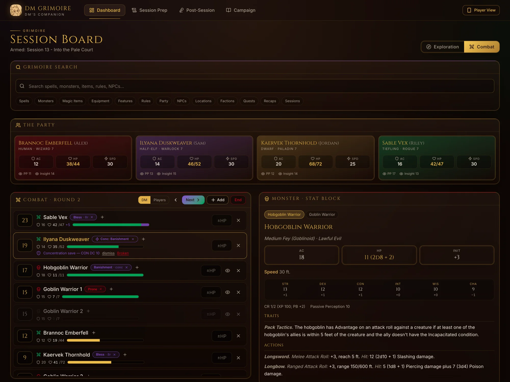
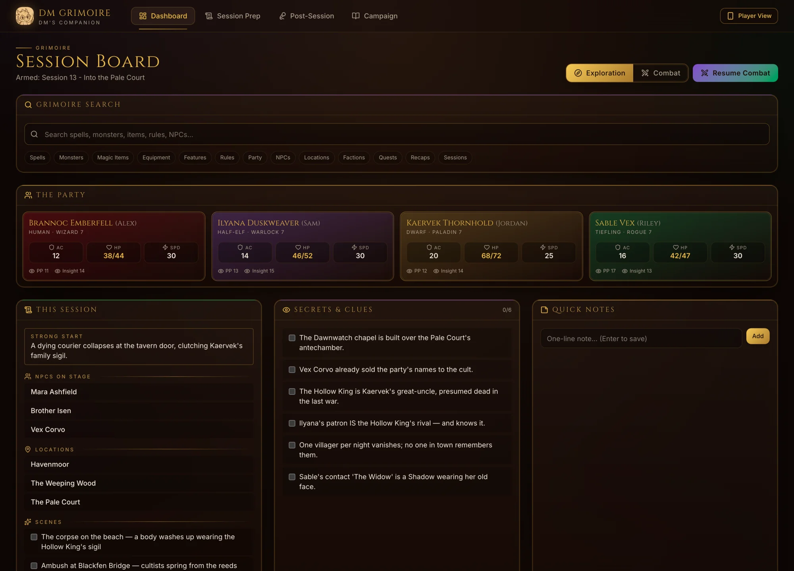
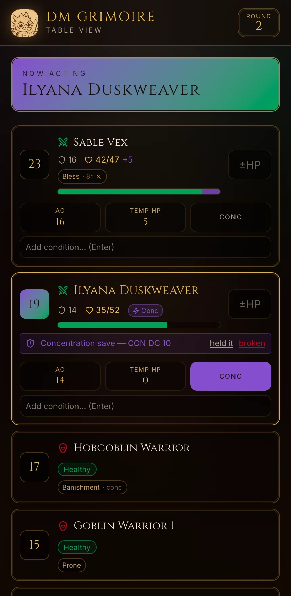
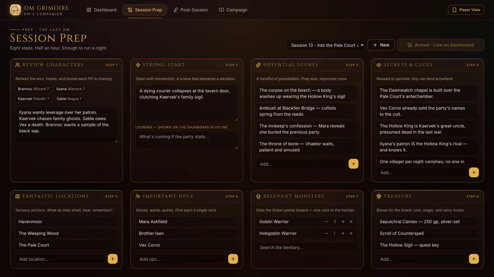
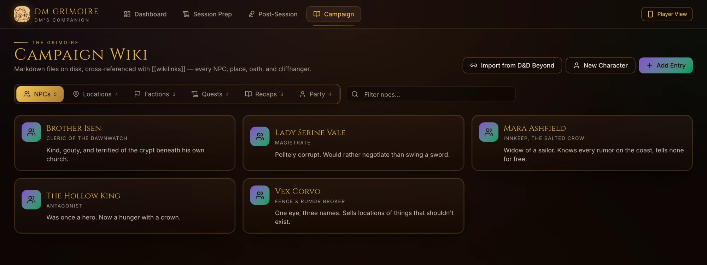

# Grimoire

A personal, local-first, open-source web app for running in-person D&D 5e (2024)
sessions: prep, fast in-session reference, live combat tracking with a table-side
player view, and post-session AI recaps — all running locally, no accounts, no cloud.

Not a VTT. Built for a single DM at a physical table.

## Screenshots

Combat is a panel, never a takeover — lookup and stat blocks stay on screen while
the tracker runs. Here the round is live: a concentration save is prompted inline
(no modal), Bless is ticking down on two PCs, and a goblin is hidden from the
players' view.



The Exploration board: universal lookup over SRD content and campaign entities,
the party bar, this session's NPCs, locations, scenes and secrets.



The Player View on a phone across the table. Players edit their own HP, AC,
conditions and initiative; enemies stay in the turn order but show only
Healthy / Bloodied / Down, and hidden enemies don't appear at all.



Session Prep, structured as the eight Lazy DM steps — monsters added here feed
the combat tracker, NPCs and locations become wiki entities.



The campaign wiki: Markdown files on disk, cross-referenced with `[[wikilinks]]`.



*Screenshots use the sample campaign the app seeds on first run.*

## Architecture

- **`frontend/`** — React + Vite + TypeScript + Tailwind CSS v4 + shadcn/ui (SPA).
- **`backend/`** — Python + FastAPI. Serves the built SPA, the API, and the
  WebSocket that syncs live combat state between the DM dashboard and player
  devices on the same Wi-Fi.
- **Storage** — campaign data as plain Markdown files on disk with `[[wikilinks]]`
  (an Obsidian-compatible vault, no Obsidian dependency).
- **AI (later milestones)** — local Whisper transcription + Ollama summarization.

See [docs/plan.md](docs/plan.md) for the full project plan.

## Development

Frontend (bun):

```sh
cd frontend
bun install
bun run dev        # Vite dev server on :5173, proxies /api and /ws to :8010
```

Backend (uv):

```sh
cd backend
uv sync
uv run grimoire    # FastAPI on :8010 (GRIMOIRE_PORT to change); serves frontend/dist if built
```

Production-ish local run: `cd frontend && bun run build`, then start the backend
and open `http://<your-lan-ip>:8010` — the Player View QR code points phones at
`/player` on the same server.

## Content

Only SRD content (CC-licensed) is committed. Homebrew and non-SRD content loads
from local folders that are gitignored and never committed.

## License

The code is [MIT licensed](LICENSE).

Game content under `content/srd/` is from the System Reference Document 5.2.1
by Wizards of the Coast LLC, licensed under
[CC BY 4.0](https://creativecommons.org/licenses/by/4.0/legalcode) — see
[content/srd/ATTRIBUTION.md](content/srd/ATTRIBUTION.md). This project is not
affiliated with or endorsed by Wizards of the Coast.
